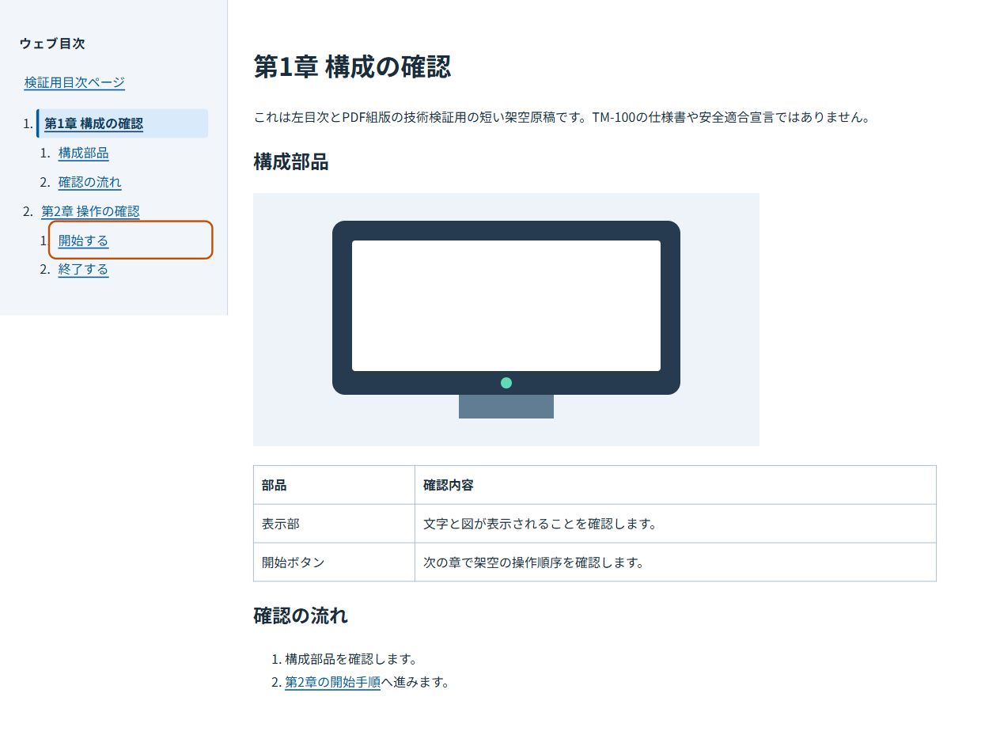
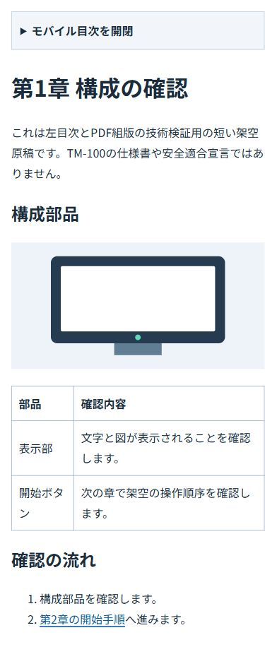
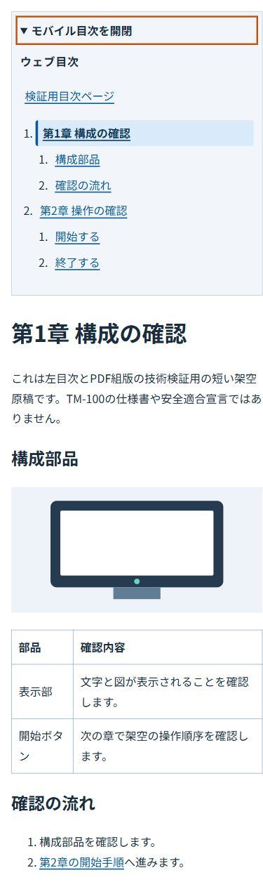

# Issue #16: 左目次 / PDF非混入スパイク

v0.1受入コミット: fc326a9f10f6564160a4688b6fc04051c48fa6e0（Issue #5 / PR #19）。
短い2章で、将来の #13 に引き継ぐ技術だけを検証します。TM-100の長文原稿・ISO適合性は対象外です。

## 実行

```sh
npm ci
npm run spike:dev
npm run spike:test
```

開発URL: http://localhost:8081/technical-manual-poc/
既定の npm run build:web、build:pdf、npm test は引き続きv0.1の manual/ を使います。
スパイクの生成物は dist-spike-web/、dist-spike-pdf/、dist-spike-review/ です。現在のPages公開対象はv0.1のままです。

## 単一マニフェスト

manual-v02/manifest.json に章順、章ID、Markdownの場所、節IDとタイトル・階層を定義します。
この1つのモデルから以下を生成します。

- 左目次とモバイル目次、現在章のaria-current
- 入口のHTML目次
- chapters/overview.html、chapters/operation.html のパスと順序
- 見出しID（実際のMarkdown見出しのタイトル・階層がずれたらビルドエラー）
- Vivliostyleのentry配列（入口目次 → 各章）

本文はEleventyのRenderPluginで一度HTML化し、WebとPDFはその生成済みHTMLを入力にします。
章を結合したmega-HTML、PDF用Markdown変換、章別PDFの結合はありません。

## Web専用UIと同一HTML

今回は別の本文ラッパーを作らず、同じ章HTMLにあるWeb UIをPDFのレイアウトフローから除外する方式を検証しました。

- 画面用CSSのgrid・sticky左目次は @media screen の中だけに定義。
- モバイルはネイティブdetails/summary。JavaScriptなしでキーボードとタッチから開閉可能。
- 本文へのスキップリンク、navラベル、フォーカス枠、現在章のaria-currentを用意。
- 追加の印刷CSSでは、画面メディアの判定だけに依存せずUIを display:none !important とし、grid・幅・余白を明示的にリセット。
- **印刷CSSを指定しただけで合格にしない。実際のVivliostyle PDFに対するテキスト、リンク、ページ数、本文開始位置、全ページ描画で確認する。**

通常の章リンク・画像・CSSは出力ファイルからの相対パスです。Pagesのプロジェクト配下とローカル配信の両方で動きます。
Vivliostyleにはローカルの生成済みHTMLをentryとして渡し、entryContextをdist-spike-web/に限定します。
印刷CSSとフォントだけは一時ローカルサーバーから取得します。

Vivliostyle内部ではHTMLを作業フォルダーへコピーしてDOMを再直列化します。これはCLI内部の処理です。
原稿の再変換や別本文を作る処理は追加していません。生成済み入力HTMLは全ファイルで前後のSHA256一致を検査します。
CLIの作業コピー自体と入力ファイルのバイト一致を主張するものではありません。

## 検証結果

| 検証 | 結果 |
| --- | --- |
| 1280px画面 | 左目次が本文の左にあり、現在章が青い背景で表示 |
| キーボード | Tabでスキップリンク・目次を移動。開始するリンクでEnterを押し、第2章の節アンカーへ移動 |
| 390px画面 | 折りたたみ目次。Tab→Spaceで開閉。開閉両方で横はみ出しなし |
| 章間リンクと画像 | 全HTMLのリンク・節ID・画像・CSSをPagesサブパスで検査 |
| PDF入力順 | entry配列とCLIのpublication.jsonがマニフェスト順と一致 |
| 実PDF | 目次1ページ＋2章の3ページ。全ページA4、連続ページ番号 |
| PDF非混入 | ウェブ目次・モバイル開閉・スキップリンク等の文言が本文に存在しない |
| PDF余白 | 本文先頭のX座標が45〜70pt。18remの左目次領域が残っていない |
| PDFリンク | 目次と章間リンクの宛先が実在する章ページに解決 |
| 入力保全 | PDF生成前後で全入力HTMLのSHA256一致 |
| v0.1 | manual/、本文テンプレート、CSSを変更せず既存回帰テストを実行 |

自動検査は npm run spike:test。実画面のキーボード・狭幅操作は手動確認です。
すべてのページの配置品質を自動判定するものではないため、本文やCSSを変更したら再度目視確認してください。

## 画面確認







## #13への引き継ぎ

- 今回のマニフェスト・見出し照合・共通レイアウト・entry生成を再利用する。
- #13で明示的な版セレクターを追加し、選択時だけdist-web/とdist-pdf/へv0.2を出力する。既定v0.1を黙って切り替えない。
- #11/#12はマニフェストの章・節IDと相対リンクを前提に原稿・図版を作成する。
- 長文の目次、長表、警告、60〜80ページの改ページ検証は #13/#15 で別途行う。今回の3ページ成功だけで長文版を受入完了にしない。
- Web用UIを変更したら、テキスト非混入・余白・リンク・ページ数と全ページの描画を再検証する。
