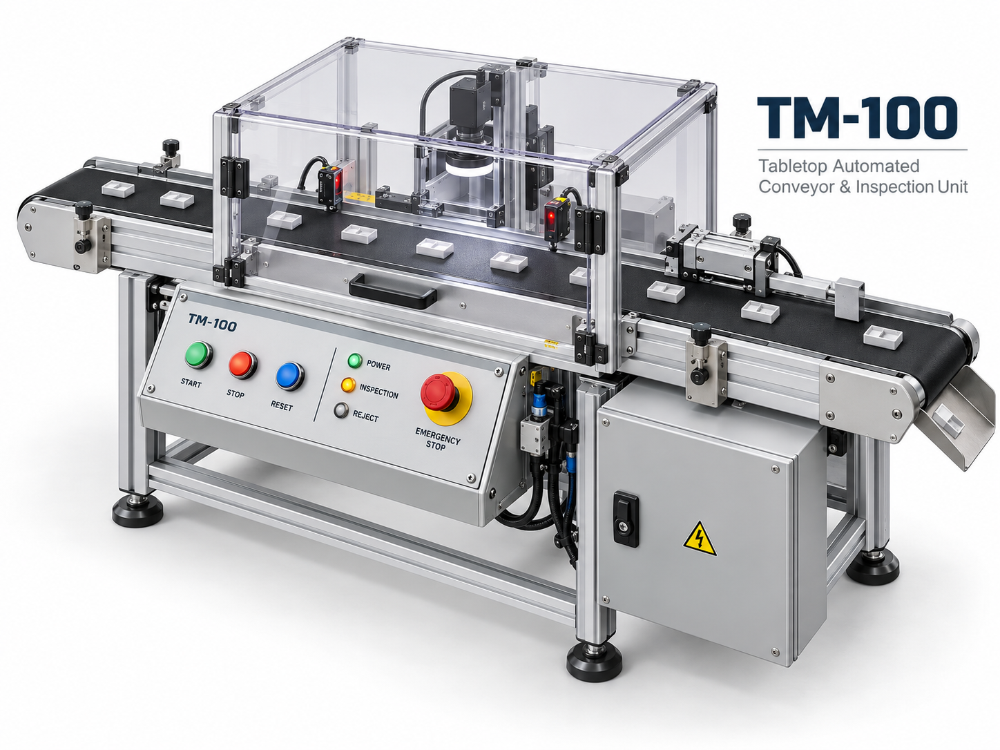

# TM-100 卓上型自動搬送・検査装置 取扱説明書

**文書番号：TM100-OM-JA-001**  
**版数：0.2**  
**発行者：TM Sample Machinery**  
**適用型式：TM-100**

*TM-100 製品外観*

## 文書の管理

| 項目 | 内容 |
|---|---|
| 文書名 | TM-100 卓上型自動搬送・検査装置 取扱説明書 |
| 文書番号 | TM100-OM-JA-001 |
| 対象機種 | TM-100 |
| 文書言語 | 日本語 |

## 改訂履歴

| 版 | 日付 | 変更概要 | 状態 |
|---|---|---|---|| 0.2-draft | 2026-10-23 | TM-100の前付、第1～3章を新規起稿 | 草稿 |

## 本書を使用する方へ

本書は機械の全ライフサイクルを対象とする総合取扱説明書を想定しています。対象読者は、運搬担当者、据付・試運転技術者、オペレーター、保守技術者、設備管理責任者です。作業者は自身の権限と習熟度に対応する章を確認し、各作業に示す安全事項に従う必要があります。資格を要する作業は、該当する資格・教育を有する者だけが行うものとします。

## 目次

1. はじめに
2. 安全上の注意
3. 装置の概要
4. 輸送・運搬・保管
5. 据付・組立・試運転
6. 初期設定・調整
7. 運転操作
8. 品種切替・段取り替え
9. 点検・保守
10. 清掃
11. 故障診断・修理
12. 撤去・解体・廃棄

付録A 主要仕様・設定値／付録B 点検記録表／付録C 警告ラベル／付録D 交換部品／付録E 用語集・索引

## 記号および表記

- **危険（DANGER）**：回避しなければ死亡または重傷に至る切迫した危険を扱う想定。
- **警告（WARNING）**：死亡または重傷につながる可能性がある危険を扱う想定。
- **注意（CAUTION）**：軽傷または中程度の傷害につながる可能性がある危険を扱う想定。
- **注記（NOTICE）**：人的危害ではなく機器損傷や品質低下に関する情報。

安全メッセージの信号語は、危害の重大さと危険の切迫性に基づいて区分します。

## お問い合わせ先

TM Sample Machinery　技術サポート

装置の製造番号、型式、現象、発生状況を記録して連絡することを想定しています。
