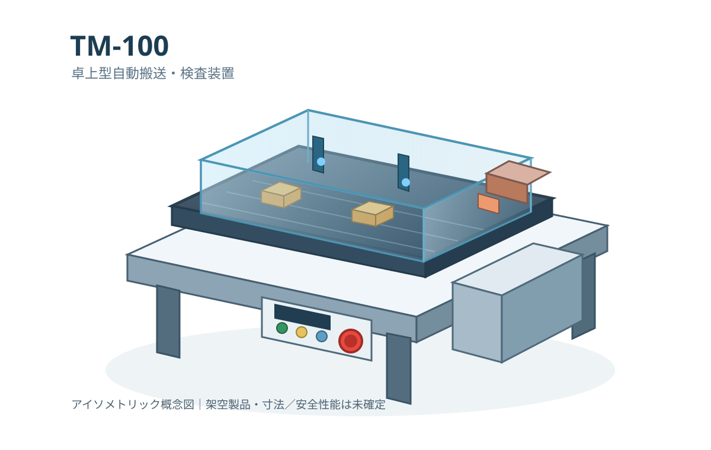

# TM-100 卓上型自動搬送・検査装置 取扱説明書

**文書番号：TM100-OM-JA-001**  
**版数：試作版 0.2-draft**  
**発行区分：技術文書出版PoC用／架空装置**  
**発行者：TM Sample Machinery（架空）**  
**適用型式：TM-100（PoC構想仕様）**

*TM-100 製品外観イメージ（架空製品・概念図。寸法および安全性能は未確定）*

> **重要：これは架空製品のサンプル文書です。** 記載した機能、寸法、電気仕様、安全装置、残留リスク、点検内容は出版システム検証のための仮定です。実在する機械への作業指示や、ISO 20607・JIS B 9719・その他規格への適合を示す資料ではありません。装置の製作・使用には設計、リスクアセスメント、検証、法令・規格の最新版本文による確認が必要です。

## 文書の管理

| 項目 | 内容 |
|---|---|
| 文書名 | TM-100 卓上型自動搬送・検査装置 取扱説明書 |
| 文書番号 | TM100-OM-JA-001 |
| 対象機種 | TM-100 |
| 文書言語 | 日本語 |
| 原稿範囲 | 前付、第1章～第3章（本PR） |
| 全体構想 | 全12章＋付録、60～80ページ |
| 準拠を目標とする構成 | ISO 20607:2019／JIS B 9719:2022の取扱説明書構成 |
| 状態 | 未完成・社内検証相当のサンプル |

## 改訂履歴

| 版 | 日付 | 変更概要 | 状態 |
|---|---|---|---|
| 0.1 | 2026-10 | 3章構成の従来PoC（別ディレクトリ） | 保存対象 |
| 0.2-draft | 2026-10-23 | TM-100の前付、第1～3章を新規起稿 | 草稿 |

## 本書を使用する方へ

本書は機械の全ライフサイクルを対象とする総合取扱説明書を想定しています。対象読者は、運搬担当者、据付・試運転技術者、オペレーター、保守技術者、設備管理責任者です。作業者は自身の権限と習熟度に対応する章を確認し、各作業に示す安全事項に従う必要があります。資格を要する作業は、該当する資格・教育を有する者だけが行うものとします。

## 目次（v0.2全体計画）

1. はじめに
2. 安全上の注意
3. 装置の概要
4. 輸送・運搬・保管
5. 据付・組立・試運転
6. 初期設定・調整
7. 運転操作
8. 品種切替・段取り替え
9. 点検・保守
10. 清掃
11. 故障診断・修理
12. 撤去・解体・廃棄

付録A 主要仕様・設定値／付録B 点検記録表／付録C 警告ラベル／付録D 交換部品／付録E 用語集・索引

第4～12章と付録は今後の制作範囲であり、本PRには実施可能な作業手順として含まれていません。Web版では章ごとのHTML、PDF版では章順に統合された1冊の文書を予定しています。

## 記号および表記

- **危険（DANGER）**：回避しなければ死亡または重傷に至る切迫した危険を扱う想定。
- **警告（WARNING）**：死亡または重傷につながる可能性がある危険を扱う想定。
- **注意（CAUTION）**：軽傷または中程度の傷害につながる可能性がある危険を扱う想定。
- **注記（NOTICE）**：人的危害ではなく機器損傷や品質低下に関する情報。

信号語の割当は実機のリスク評価から再決定する必要があります。本書の分類はレイアウト検証用の例示です。

## お問い合わせ先（架空）

TM Sample Machinery　技術サポート（連絡先は設定していません）

装置の製造番号、型式、現象、発生状況を記録して連絡することを想定しています。現実の問い合わせ先はありません。
