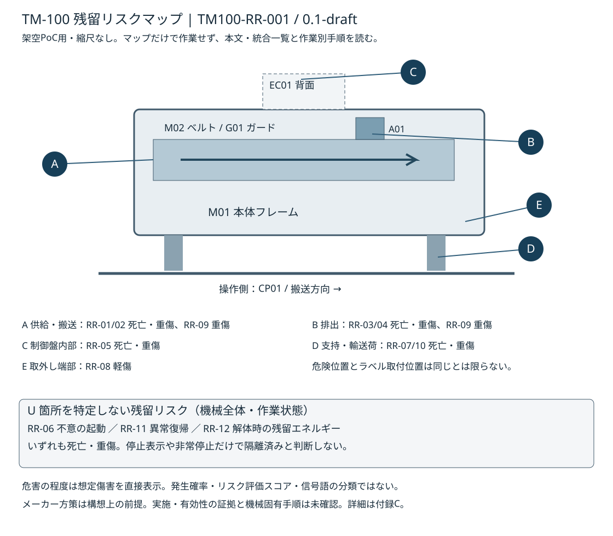
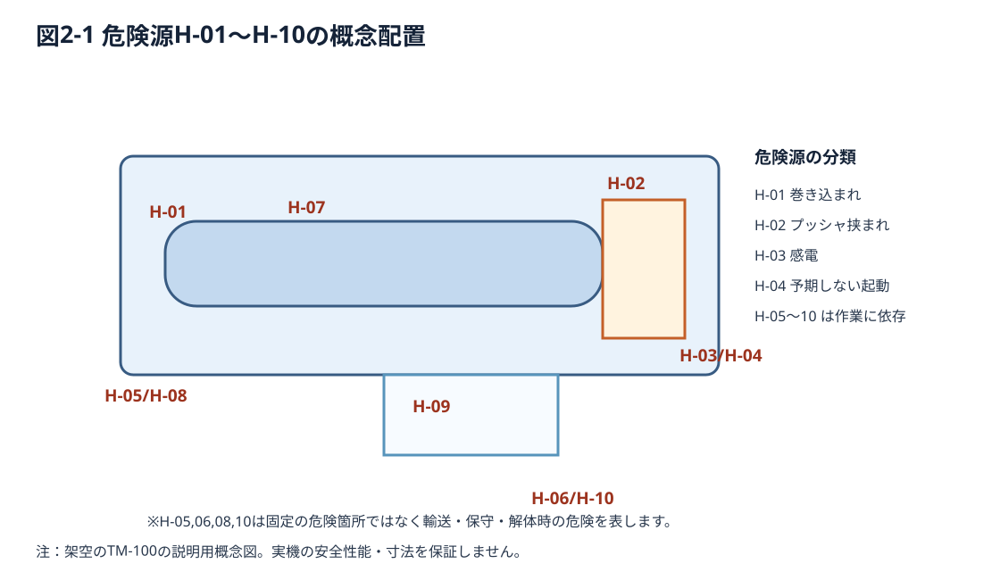
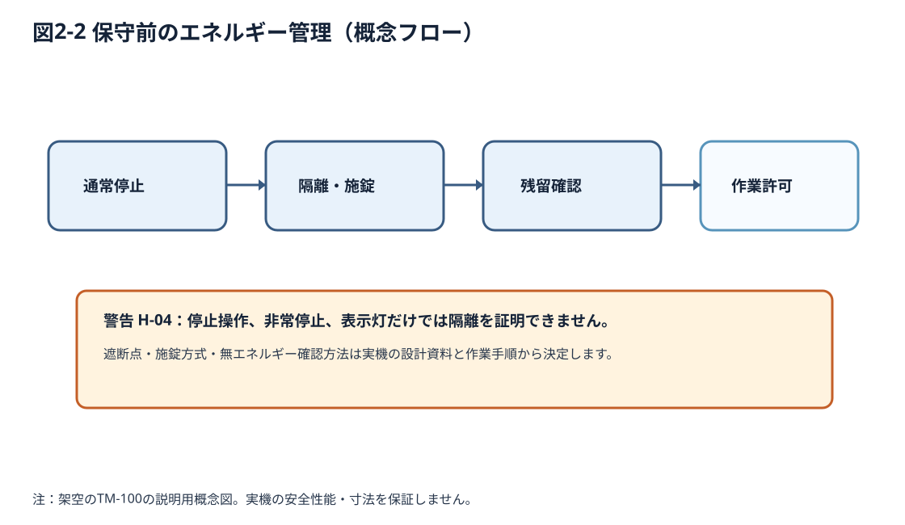

# 第2章 安全上の注意

## 2.1 安全情報を読む前に

本章では、TM-100の輸送、据付、運転、保守および撤去に共通する安全事項を説明します。作業の前に本章と関連する作業手順を読んでください。

作業固有の警告は、各作業手順の近傍にも掲載します。本章を読んだだけで、設置、修理、電気工事などの作業を行えるものではありません。

## 2.1.1 残留リスクマップと統合一覧

危険位置・危害・ユーザー側方策・必要教育は[付録Cの残留リスク・警告ラベル統合一覧](appendices/c-warning-labels.md)を参照してください。マップや一覧だけで作業せず、本章と当該作業の手順を理解してください。

## 2.2 安全メッセージの区分

| 区分 | 意味 | 代表例 |
|---|---|---|
| 危険（DANGER） | 回避しなければ死亡または重傷に至る切迫した危険 | 通電中の露出充電部への接触 |
| 警告（WARNING） | 重大な人的危害のおそれ | 搬送部への巻き込まれ |
| 注意（CAUTION） | 比較的軽度の人的危害のおそれ | 部材の鋭利な端面 |
| 注記（NOTICE） | 主に物的損害の防止 | 指定外清掃液によるセンサ破損 |

警告文には原則として「危険源・想定される結果・回避する行動」を含めます。ISO/ANSI等の信号語や図記号との対応は実機採用前の個別評価を要します。

## 2.3 安全に関する基本原則

- 機械を使用する前に、担当業務に応じた教育を完了する。
- ガード、非常停止装置、インターロックを取り外したり無効化したりしない。
- 異常な音、振動、焦げ臭、過熱、ワークの詰まりが認められたら運転を停止する。
- 服、髪、手袋、アクセサリー等が可動部に巻き込まれないようにする。
- 点検や清掃で危険領域に入る場合は、適切に停止し、エネルギーを隔離して、再起動を防止する。
- 異常後の再開は原因を除去し、安全装置と運転領域を確認してから行う。
- 設備管理責任者が承認していない改造、用途変更、配線変更を行わない。

## 2.4 危険源と残留リスク

| ID | 危険源 | 想定される危害 | 主なリスク低減策の例 | 関連作業 |
|---|---|---|---|---|
| H-01 | コンベヤとローラの挟圧点 | 指・衣服の巻き込まれ | 固定ガードとアクセス制限 | 運転・清掃・保守 |
| H-02 | 電動プッシャ | 指の挟まれ | ガード、運転停止の確認 | 段取り・故障対応 |
| H-03 | 電源配線・制御盤 | 感電、熱傷 | 保護接地、隔離、資格者による作業 | 据付・保守 |
| H-04 | 予期しない起動 | 可動部による負傷 | エネルギー遮断と再起動防止 | 保守・清掃 |
| H-05 | 運搬時の荷の落下 | 足部・手部の損傷 | 適切な荷扱いと固定 | 輸送・据付 |
| H-06 | 鋭利な端部・交換部品 | 切創 | 安全な取扱い、適切な手袋 | 保守・廃棄 |
| H-07 | 不安定なワークの飛散 | 打撲、眼の損傷 | ワーク仕様順守、ガード | 自動運転 |
| H-08 | 不安定な据付 | 機械の移動・転倒 | 作業台への確実な固定 | 据付 |
| H-09 | 異常復旧時の誤操作 | 再起動による挟まれ | 原因確認、リセットと始動の分離 | 復旧 |
| H-10 | 解体中の残留エネルギー | 感電、挟まれ、切創 | 隔離、無エネルギーの確認 | 解体 |

各危険源に対応する安全措置は、関連章に示します。

*図2-1 危険源の概念配置。危険が発生する作業条件と固定位置を区別しています。*

## 2.5 可動部による危険

### 2.5.1 コンベヤへの巻き込まれ（H-01）

[[safety:W-02]]

運転中にベルト上のワークを手で押し戻したり、ローラ周辺の汚れを拭いたりしないでください。ガードの開閉を伴う作業は運転手順と保守手順で区別します。

### 2.5.2 排出プッシャの挟まれ（H-02）

[[safety:W-03]]

制御表示が「停止」を示していても、危険エネルギーが完全に除去された証明にはなりません。必要な作業では装置の主電源を隔離し、再投入されないことを確実にします。

## 2.6 電気的危険（H-03）

[[safety:D-01]]

電気機器に水や導電性液体をかけないでください。電源ケーブルの損傷、異常発熱、発煙が認められた場合は安全に電源を遮断し、使用を中止します。

## 2.7 予期しない起動とエネルギー遮断（H-04）

[[safety:W-04]]

エネルギー源として、商用電源、制御電源、可動部の運動、ワークの位置エネルギーを想定します。設備に実際に存在するエネルギー源と遮断点を設計情報から確認する必要があります。

### 2.7.1 保守作業の安全確認の考え方

1. 運転を停止し、危険領域にあるワークの状態を確認する。
2. 許可された隔離点でエネルギーを遮断する。
3. 他者による再投入を防止する措置を適用する。
4. 必要な確認方法で危険エネルギーがないことを検証する。
5. 作業完了後は工具・部品・人員の退避、ガード復旧を確認する。
6. 設備管理責任者が定める再通電・試運転手順を実施する。

*図2-2 保守前のエネルギー管理。実機の隔離手順を示すものではありません。*

遮断点、放電時間および無エネルギー確認方法は設備の作業標準に従ってください。

## 2.8 非常停止と保護装置

TM-100には、操作パネルの非常停止ボタン、固定ガード、インターロック付き可動ガードを設けています。安全機能の確認は定められた点検手順で実施してください。

- 非常停止は緊急時に危険な動作を停止させるための補助的保護方策です。
- 非常停止は電源隔離や安全な保守作業手順の代用ではありません。
- 非常停止の解除やガードの再閉鎖だけで自動再起動しない設計を想定します。
- 保護装置に不具合がある場合は装置を運転しません。

[[safety:W-05]]

始業前は[第5章5.5](05-installation.md)の非常停止・カバーG02・開口部エリアセンサーS03の3点検を実施してください。動作不具合発見時は直ちに電源を切りサービス窓口へ連絡し、運転を禁止してください。

## 2.9 輸送・設置時の危険（H-05、H-08）

[[safety:W-06]]

[[safety:W-06]]

本書では外形寸法や質量を設定しますが、実機に対する運搬方法は必ず実測値・設計値で確定してください。

## 2.10 ワークの飛散・詰まり（H-07、H-09）

[[safety:W-07]]

[[safety:W-08]]

「リセット」は安全機能の解除条件を確認する操作であり、通常運転を開始する操作と分離する想定です。

## 2.11 保守・清掃・解体の危険（H-06、H-10）

[[safety:C-02]]

[[safety:W-09]]

[[safety:N-02]]

[[safety:D-02]]

[[safety:C-03]]

[[safety:N-03]]

## 2.12 個人用保護具と作業環境

個人用保護具は作業・リスクに応じて選定し、ガードその他の保護方策の代わりにはしません。通常運転では身体に密着した服装を基本とし、保守・搬送では必要に応じて安全靴、保護眼鏡、切創防止手袋等を用いる想定です。ただし、回転部に巻き込まれる恐れのある手袋の使用は別途評価してください。

作業場所は整理整頓し、照度を確保し、床面や電源配線でつまずかないようにします。保守範囲内へ第三者が立ち入らないように管理します。

## 2.13 意図する使用と予見可能な誤使用

意図する使用は、規定サイズの乾燥した樹脂製ワークを、指定のガードを閉じた状態で搬送・検出・排出することです。

次の行為を想定される誤使用として排除します。

- 人、動物、液体、粉体、鋭利または加熱された物の搬送。
- 保護ガードを開けたままの自動運転。
- 検出不良の確認を目的に、運転中のワークへ手を出すこと。
- 停止表示のみを確認して危険領域へ入ること。
- 定められた範囲外の速度・ワーク寸法での運転。
- 非常停止装置を通常の運転停止スイッチとして常用すること。
- 安全回路・警告表示の取り外しまたは改造。

## 2.14 安全情報の照合

| 危険源 | 主なメッセージ | 詳細を追加する予定の章 |
|---|---|---|
| H-01 | W-02 | 7、9、10 |
| H-02 | W-03 | 7、8、11 |
| H-03 | D-01 | 5、9、12 |
| H-04 | W-04 | 9、10、11 |
| H-05 | W-06 | 4、5 |
| H-06 | C-02 | 9、12 |
| H-07 | W-07 | 7 |
| H-08 | C-01 | 5 |
| H-09 | W-08 | 7、11 |
| H-10 | W-09 | 12 |
