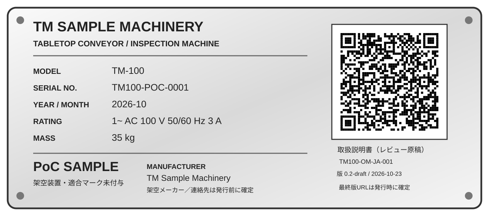
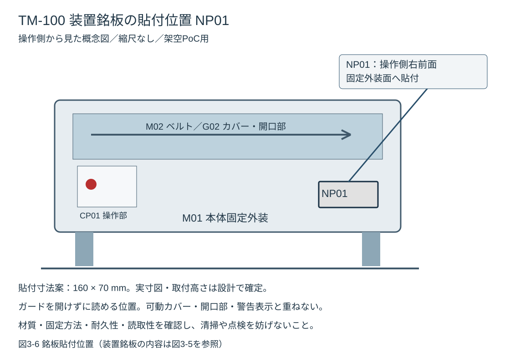

# 第3章 装置の概要

## 3.1 装置の目的と機能

TM-100は、小型の樹脂製ワークをベルトコンベヤで搬送し、光電センサによって通過状態を検出し、設定条件に基づいてワークを合格品または不合格品に仕分ける卓上型の自動搬送・検査装置です。

装置の全体構成を図3-1に示します。

*図3-1 全体外観・搬送方向*

動作は、(1)作業者または前工程からのワーク供給、(2)搬送、(3)光電検出、(4)判定、(5)良品の通過またはプッシャによる排出、(6)状態・個数の表示、という流れを想定しています。

## 3.2 主要構成

| 機器番号 | 名称 | 主な機能 |
|---|---|---|
| M01 | 本体フレーム | 搬送・制御ユニットを支持する |
| M02 | ベルトコンベヤ | ワークを供給側から排出側へ搬送する |
| M03 | 搬送モータ | ベルトを駆動する |
| S01 | ワーク検出センサ | 搬送途中のワークの有無を検出する |
| S02 | 判定用光電センサ | 想定する検査位置でワークを検出する |
| A01 | 電動プッシャ | 不合格ワークを排出する |
| G01 | 固定ガード | ローラ周辺などへの接近を抑制する |
| G02 | 可動ガード | 点検アクセス部を覆う。開閉状態を監視する構想 |
| CP01 | 操作パネル | 運転、停止、リセット、状態表示を行う |
| EC01 | 制御盤 | 制御機器・電源機器を収納する |

*図3-2 主要機器番号と構成*

機器番号は図版、部品リスト、警告表示と同一の識別子を用います。位置や個数は機器配置図で確認してください。

## 3.3 搬送・判定のプロセス

1. ワークが供給側に投入される。
2. ワーク検出センサS01が搬送物を検出する。
3. 設定速度でベルトがワークを搬送する。
4. 判定用センサS02の信号と運転設定から仕分け判定を行う。
5. 不合格と判定したワークのみ、電動プッシャA01を動作させる。
6. 装置は排出結果、運転状態、異常状態を表示する。

判定条件は対象ワークの品種設定に従います。

## 3.4 想定仕様

| 区分 | 項目 | 仕様 |
|---|---|---|
| 電気 | 定格入力電源 | 単相 AC 100 V、50/60 Hz |
| 電気 | 制御電源 | DC 24 V |
| 搬送 | 方式 | 電動ベルト |
| 搬送 | 速度設定 | 0.05～0.20 m/s |
| ワーク | 材質 | 乾燥した非導電性の樹脂部品 |
| ワーク | 幅 | 20～80 mm |
| ワーク | 長さ | 30～120 mm |
| ワーク | 外形 | 直方体、安定した平底 |
| 設置 | 使用場所 | 屋内・乾燥環境 |
| 安全 | 保護装置 | 固定ガード、インターロック付き可動ガード |
| 安全 | 非常停止 | 操作パネル上の非常停止ボタン |

装置寸法、質量、重心、電流値、環境条件および安全性能の詳細は、装置仕様書と設計図面を参照してください。

## 3.5 意図する使用

装置は、教育を受けた担当者が、規定のワークを指定条件内で搬送・検出・仕分けするために使用することを想定しています。手動でワークの姿勢を整える場合は装置の停止条件と安全なアクセス方法が定義されている必要があります。

本書で想定しない使い方は、第2章2.13「意図する使用と予見可能な誤使用」を参照してください。

## 3.6 装置のレイアウトと危険箇所

搬送方向は、操作位置から見て一方向とし、供給側、検出位置、排出位置、良品出口の順に配置する構想です。

| エリア | 含まれる主な機器 | 関連する危険源 |
|---|---|---|
| 供給エリア | ベルト、ワークガイド、S01 | H-01、H-07 |
| 検出エリア | S02、固定ガード | H-01 |
| 仕分けエリア | A01、排出シュート | H-02、H-07 |
| 操作エリア | CP01、非常停止ボタン | H-09 |
| 制御エリア | EC01、電源部 | H-03、H-04 |

危険箇所の位置は第2章の図2-1も参照してください。外形寸法と保守空間の考え方を図3-3に示します。

*図3-3 外形寸法と設置余裕*

## 3.7 操作パネル

| 操作・表示部 | 機能 | 操作・表示の考え方 |
|---|---|---|
| 運転ボタン | 自動運転開始 | 安全条件成立後に受け付ける |
| 停止ボタン | 通常停止 | 運転シーケンスを停止する |
| リセットボタン | 異常状態の確認・復旧 | 押しただけで自動再起動しない |
| 非常停止ボタン | 緊急時の危険動作停止 | 保守用の隔離手段ではない |
| 状態表示灯 | 状態通知 | 色に加えて文字情報を併記する想定 |
| 簡易表示器 | 運転条件・異常コード | 停止理由や作業者への指示を示す |

*図3-4 操作パネルの概念図。リセットと運転開始は独立操作とする。*

状態表示は、停止・準備完了・自動運転・異常・非常停止の5区分を基本とします。実機の表示色や非常停止機能は関連規格と制御設計に基づき決定します。

## 3.8 動作モード

| モード | 動作の概要 | 主に使用する担当者 |
|---|---|---|
| 停止 | 駆動が停止した通常状態 | オペレーター |
| 準備完了 | 起動のための条件成立を確認した状態 | オペレーター |
| 自動運転 | 搬送・検出・仕分けが連続動作する | オペレーター |
| 異常 | エラーを検出し、必要な停止処理を行った状態 | オペレーター、保守技術者 |
| 保守 | 許可された保守作業のための状態 | 保守技術者 |

「停止」や「保守モード」を表示しても、危険エネルギーがないことの保証にはなりません。ガードを開放する作業については第2章2.7の安全原則を適用します。

## 3.9 安全関連構成の説明

装置の保護方策を以下に示します。

- ローラ部を覆う固定ガードG01。
- 保守アクセス部を覆う可動ガードG02と開閉監視。
- 操作部の非常停止ボタン。
- 異常復帰時のリセット操作と、別個の運転開始操作。
- 保守時のエネルギー隔離を前提とした電源接続と作業手順。

ガードや安全制御の変更は禁止します。点検は第9章に従ってください。

## 3.10 装置銘板および警告ラベル

装置銘板NP01を本体M01の操作側右前面の固定外装面へ貼付します。ガードを開けずに読める位置とし、可動カバー、開口部、警告ラベルへ重ねません。

*図3-5 装置銘板NP01（架空PoC用）。参考レイアウトの項目配置を採用し、実際の機器仕様に合わせています。*

| 項目 | 記載内容 |
| --- | --- |
| 製造者 | TM Sample Machinery（架空） |
| 装置名称 | 卓上型自動搬送・検査装置 |
| 型式 | TM-100 |
| 製造番号 | TM100-POC-0001（架空） |
| 製造年月 | 2026-10（架空） |
| 定格入力 | 単相AC100 V、50/60 Hz、3 A（架空仕様） |
| 質量 | 35 kg（架空仕様） |
| 対応説明書 | TM100-OM-JA-001 / 0.2-draft / 2026-10-23 |

*図3-6 銘板貼付位置。取付高さ、固定方法と材質は実設計で確定します。*

寸法案は160×70 mmです。実寸印刷・取付面・耐久性・日本語可読性・QR読取性を確認してから製作仕様を決定します。
QRはレビュー原稿へのリンクです。発行時には当該機械に適用する固定版の取扱説明書URLへ変更し、内容・版の一致と継続アクセスを確認します。現在のGitHub Pagesのv0.1はTM-100本原稿ではありません。
参照画像のCE表示やEU適合宣言書への案内は本PoCには付与しません。適合評価・宣言・製造者情報の確定後に、適用される表示を別途判断します。
サービス窓口の住所・電話・メールは発行前に確定してください。型式・製造番号・製造年月は説明書、点検記録、サービス連絡で同じ識別を使います。

警告ラベルL-01〜L-06と残留リスクの対応は[付録C](appendices/c-warning-labels.md)を参照してください。装置銘板は警告ラベルの代わりにはなりません。

## 3.11 使用上の制限

- 速度とワーク寸法以外の性能値は指定の検査記録で確認してください。
- ワークの質量・高さが仕様書に基づいて確認するため、搬送負荷や飛散限界は決定できません。
- 電気定格、消費電力、保護接地条件は製作図面により確認する必要があります。
- 据付の固定具、作業台の必要耐荷重は質量と重心の確定後に決定します。
- 必要な保守周期と交換部品の寿命は指定の検査記録で確認してください。
- 安全装置の有効性、停止時間、残留リスク評価は未実施です。

関連する仕様書と設計図面は付録Aを参照してください。
