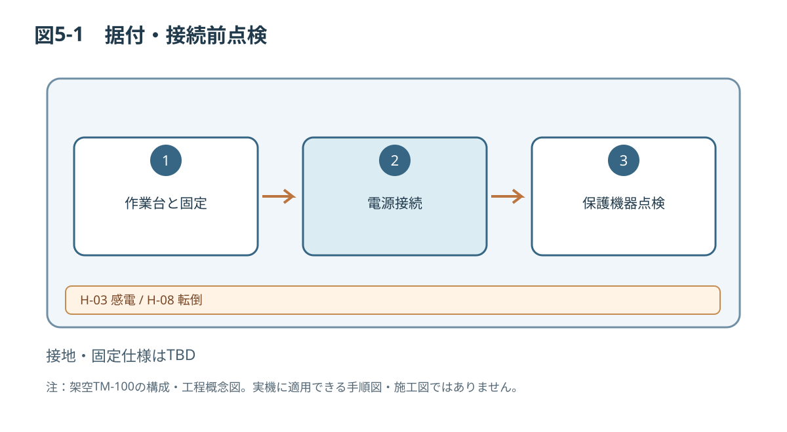

# 第5章 据付・組立・試運転

> **PoC用の架空機械に関する原稿です。** 設計値・危険区域・安全性能は未検証です。実際の輸送、据付、運転、保守、解体には使用できません。数値が未確定の箇所はTBDとし、推測値で補完しません。

## 5.1 対象と作業許可
本章は据付技術者と設備管理責任者が対象です。電気接続は適切な資格と権限を有する技術者に限ります。設備質量、外形、重心、保護接地、電源定格の最終値は未確定であり、作業開始前の設計ゲートとします。

## 5.2 据付条件
| 項目 | 要求条件／判定方法 |
|---|---|
| 作業台 | 本体・ワーク・作業荷重に対する強度を確認（数値TBD） |
| 床面・作業台水平度 | メーカー確定公差内（TBD） |
| 固定 | 指定取付位置・ボルト仕様（TBD） |
| 作業・保守空間 | 図3-3のTBD寸法確定後に確認 |
| 周囲環境 | 乾燥した屋内、結露や危険雰囲気がない |
| 電源 | 単相AC100V、50/60Hzは構想値。実機表示と照合 |
| 接地 | 設計された保護接地方法を電気担当者が検証 |

## 5.3 危険情報
> **警告 W-06／H-05：据付中の落下**  
> 持上げ点や荷重を確認しない据付は落下事故につながります。設計確定と運搬計画の承認なしに装置を持ち上げないでください。

> **危険 D-01／H-03：通電部への接触**  
> 電気的隔離および無電圧確認を行わずに電気系を接続すると致命的な感電のおそれがあります。資格と権限を有する担当者が、適用法規と電気設計資料に従って作業してください。

> **注意 C-01／H-08：不適切な固定**  
> 本体の移動や転倒を避けるため、指定した据付固定部と台の耐荷重を検証してください。

## 5.4 据付作業の流れ（概念）
1. 搬入・受入記録を確認し、未処理の損傷・欠品がないことを確かめる。
2. 据付図面と施工計画を承認する。寸法、重心、固定具がTBDの場合はここで作業を停止する。
3. 作業場所、台の耐荷重、保守スペースと立入管理を確認する。
4. 指定された方法で装置を移動・配置する。
5. 水平と固定状態を測定・記録する。
6. ガードG01/G02、S01/S02、プッシャA01、制御盤EC01の損傷や脱落がないか確認する。
7. 電気担当者が電源・接地・保護機器を設計書に従って確認する。
8. 結線・保護装置確認記録を承認し、試運転段階へ移る。

## 5.5 初回通電前チェック
| チェック項目 | 確認結果 | 担当 |
|---|---|---|
| 固定、安定性、設置クリアランス | □適 □否 | 据付 |
| ガードの損傷・固定状態 | □適 □否 | 据付 |
| 非常停止・ガード監視の設計検証 | □適 □否 | 安全担当 |
| 配線・接地・保護機器 | □適 □否 | 電気担当 |
| ワークなし・危険区域無人 | □適 □否 | 試運転 |
| 是正事項の完了 | □適 □否 | 管理責任者 |

## 5.6 試運転・受入
試運転は安全機能の検証済み手順で段階的に行う想定です。無負荷運転、停止、非常停止、ガードの動作、リセットと再起動の分離、センサ動作、ダミーワークの搬送・排出を確認し、結果を記録します。**非常停止やインターロックの試験方法、合格停止時間、機能安全の達成性能は設計未確定のため本書で指示しません。**

不合格が一つでもある場合は通常運転へ引き渡さず、不適合処理と再検証を行います。

関連：第2章2.6～2.9、第3章3.7、第6章。

*図5-1：TM-100の技術文書検証用概念図（寸法・安全性能は未確定）*

関連：第2章2.6～2.9、第3章3.7、第6章。
