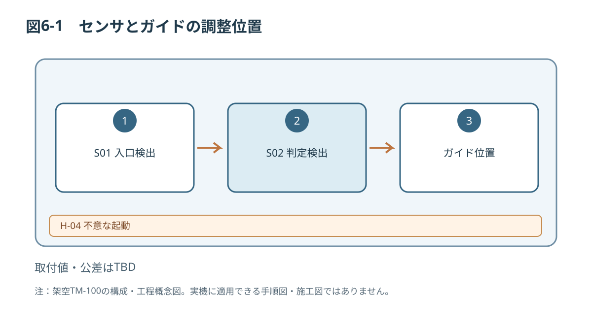
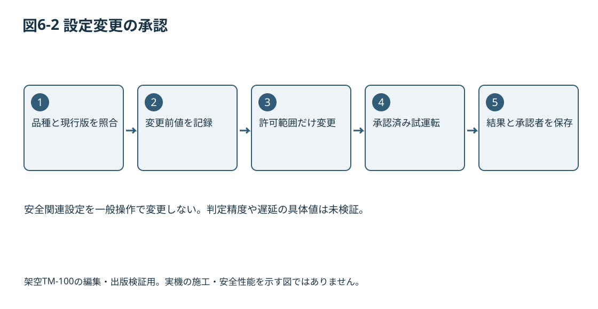

# 第6章 初期設定・調整

## 6.1 適用範囲と作業者
本章は据付・試運転技術者および承認された保守技術者を対象とします。初期設定は搬送速度、光電センサ検出条件、ワークガイド位置および検査判定パラメータを想定します。安全機能に関する設定値は本章で任意変更しません。

## 6.2 調整前の安全条件
[[safety:W-04]]

危険領域への接近を伴う調整と、ガード外からの設定変更は別手順として扱います。安全機能を無効化した状態での調整を前提としません。

## 6.3 初期設定台帳
| ID | 項目 | 設定範囲・値 | 記録方法 |
|---|---|---|---|
| P-01 | 搬送速度 | 0.05～0.20 m/s | 設定値・実測値 |
| P-02 | S01検出閾値 | 仕様書参照 | 承認値 |
| P-03 | S02判定閾値 | 仕様書参照 | 承認値 |
| P-04 | プッシャ動作遅延 | 仕様書参照 | 承認値 |
| P-05 | ワークガイド間隔 | ワーク寸法に合わせ仕様書参照 | 実測 |
| P-06 | 安全関連設定 | 未定・一般操作不可 | 設計承認記録 |

[[safety:N-03]]

## 6.4 初期設定の流れ
1. 対象ワークの材質・寸法・外観を確認する。
2. 必要な資格、作業許可、安全状態を確認する。
3. 搬送ガイドを承認された調整範囲内に合わせ、固定状態を確認する。
4. S01とS02の取り付け状態と検出方向を確認する。
5. ガード外から設定可能なパラメータを記録したうえで入力する。
6. 設計承認済み試運転手順でワークを通し、検出・排出動作を観察する。
7. 想定と異なるときは停止し、原因を記録する。安全装置を無効化して再試行しない。
8. 合格した設定を台帳に登録し、管理責任者の承認を得る。

## 6.5 設定変更の管理
設定変更時には「変更前値、変更後値、目的、対象ワーク、担当者、承認者、検証結果」を記録します。制御プログラム、安全パラメータ、保護機器設定は設計変更として別途管理し、本書の一般的な段取り替えには含めません。

## 6.6 受入基準
センサの誤検出率、搬送ばらつき、判定精度、排出成功率は未評価で**仕様書参照**です。第7章の運転条件と矛盾しないように、検証完了後に確定します。

*図6-1：TM-100の技術文書概念図（寸法・安全性能は未確定）*

関連：第3章3.2、3.4、第8章。

*図6-2 設定変更の承認。安全関連設定を一般操作で変更しない。判定精度や遅延の具体値は未検証。*
