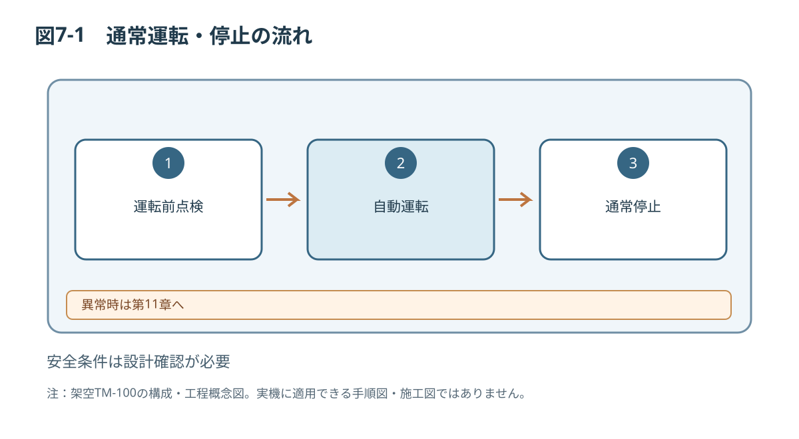
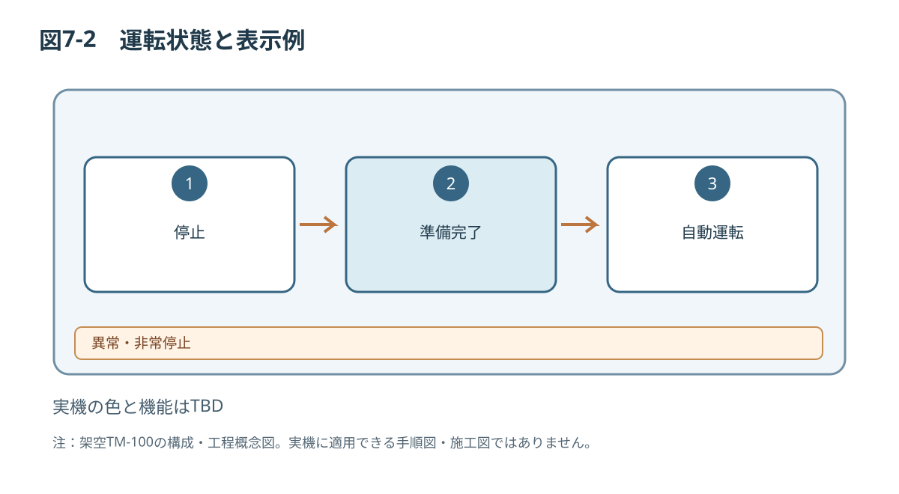

# 第7章 運転操作

> **PoC用の架空機械に関する原稿です。** 設計値・危険区域・安全性能は未検証です。実際の輸送、据付、運転、保守、解体には使用できません。数値が未確定の箇所はTBDとし、推測値で補完しません。

## 7.1 対象者・運転の前提
対象者は教育と運転許可を受けたオペレーターです。TM-100は乾燥した直方体樹脂ワーク（幅20～80 mm、長さ30～120 mm）を搬送する架空装置です。最大ワーク高さ・質量、処理能力、判定精度はTBDです。

## 7.2 運転前点検
| 項目 | 判定基準 |
|---|---|
| ガードG01/G02 | 外れ、破損、異常な開放がない |
| 非常停止・操作部 | 物理的損傷がない。機能試験は別途承認手順 |
| 搬送ベルト | 異物、著しい損傷、片寄りがない |
| センサS01/S02 | 汚れ、ゆるみ、配線損傷がない |
| 排出部A01 | 妨害物・堆積物がない |
| 周囲 | 人員と障害物が危険範囲にない |
| 対象ワーク | 形状・寸法が許可範囲内 |

不適合がある場合は運転しません。点検結果の記入様式は付録Bを参照してください。

## 7.3 危険情報
> **警告 W-02／H-01：ベルト・ローラへの巻き込まれ**  
> 運転中に手や衣服が接触すると重傷のおそれがあります。可動部へ手を入れないでください。

> **警告 W-03／H-02：排出プッシャによる挟まれ**  
> プッシャの作動範囲に手を入れると挟まれる危険があります。運転中はガードの内側へ入らないでください。

> **警告 W-07／H-07：ワークの飛散**  
> 指定外のワークを搬送すると飛散して負傷するおそれがあります。承認されたワークのみを投入してください。

## 7.4 運転開始（作業例）
1. 運転前点検が合格していることを確認する。
2. 指定ワークおよびレシピが一致することを確認する。
3. ガードが正しい状態にあり、危険区域内に人がいないことを確認する。
4. 機械の起動条件が成立していることを表示器で確認する。
5. 運転ボタンを操作して自動運転を開始する。
6. 搬送、検出、仕分けが期待どおりであることを安全な位置から確認する。

安全関連制御の起動許可ロジックは未確定です。この手順はUIと本文検証用のシナリオです。

## 7.5 自動運転中の監視
ワーク供給の偏り、検出状態、排出状態、異音、異常振動、ベルトの蛇行、エラー表示を監視します。ワーク詰まり、ガード異常、異常な動作があれば停止操作を行い、装置には近づかず原因を報告します。

## 7.6 通常停止
1. 新しいワークの供給を停止する。
2. 停止ボタンを操作する。
3. 表示が停止に変化したことを確認する。
4. ワークの残留、周囲安全、異常表示を記録する。

**停止表示はエネルギー遮断を意味しません。** 清掃・保守で危険区域に入る場合は第9～10章の安全条件を適用します。

## 7.7 非常停止
緊急事態では非常停止装置を使用します。安全が確保された後に管理責任者が原因を確認します。解除する前に人員・工具・ワークを確認し、リセットと運転開始を独立した操作で実施する想定です。実際の解除・復帰方法は安全関連制御の検証後に確定する必要があります。

## 7.8 異常停止からの復帰
> **警告 W-08／H-09：原因を除去しない再始動**  
> 誤復帰は再起動時の挟まれ・飛散につながるおそれがあります。原因、ガード状態、ワーク残留、危険区域への立入りがないことを確認してから再開してください。

1. エラーコード、停止直前の運転条件、対象ワークを記録する。
2. 権限内で実施できる点検か判断する。危険区域内の詰まり除去は保守技術者へ引き継ぐ。
3. 許可された方法で異常原因を除去する。
4. ガード、安全関連状態、復帰条件を確認する。
5. 独立したリセット操作の後、作業許可者が運転開始する。
6. 再発する場合は停止し、第11章の故障診断に従う。

## 7.9 運転記録
| 日時 | ワーク品種 | レシピ | 稼働時間 | 合格数 | 排出数 | 異常コード | 担当 |
|---|---|---|---|---|---|---|---|
| （記入例） | A | R-01 | TBD | TBD | TBD | なし | オペレーター |

*図7-1：TM-100の技術文書検証用概念図（寸法・安全性能は未確定）*

*図7-2：TM-100の技術文書検証用概念図（寸法・安全性能は未確定）*

