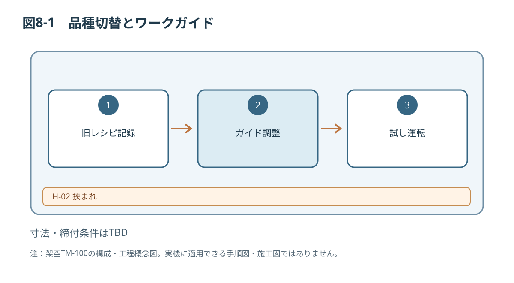

# 第8章 品種切替・段取り替え

## 8.1 対象と適用条件
品種切替は指定の樹脂ワーク間の変更を対象とします。オペレーターが行える設定変更と、保守技術者の作業を要する機械的調整を区別します。

## 8.2 作業前の確認
| 項目 | 確認事項 |
|---|---|
| 新品種 | 材質、幅20～80 mm、長さ30～120 mm |
| 制限条件 | 高さ10〜50 mm・質量最大0.2 kg（架空）、搬送安定性は承認結果と照合、未承認品種不可 |
| レシピ | 登録番号、変更履歴、承認状態 |
| 残留ワーク | 搬送路と排出部の残数 |
| 作業許可 | 調整内容と必要資格、隔離要否 |

[[safety:W-03]]

## 8.3 レシピ変更（ガード外操作の例）
1. 供給を停止し、正常停止を確認する。
2. 現行レシピ番号、運転実績、ワークの残留状況を記録する。
3. 承認済みの新品種とレシピ番号を照合する。
4. 変更可能な画面からレシピを選択する。
5. 設定値の上限・下限が承認済み範囲内であることを確認する。
6. 設備管理責任者が定める試し運転手順へ進む。

## 8.4 ガイド位置調整（機械作業の例）
必要な停止・隔離・再起動防止を完了した後、保守担当者は指定の調整具でガイド位置を変更し、固定状態を記録します。取付ボルトの締付トルク、調整目盛り、許容誤差は仕様書参照のため、具体値を指示しません。

## 8.5 試し運転と復帰
ガードを復旧し、危険領域内に人がいないことを確認してから、承認された試し運転を実施します。ワークの姿勢、センサ検出、排出動作、搬送詰まりの有無を確認します。合格基準は品種ごとに管理し、不合格なら運転へ引き渡しません。

## 8.6 切替記録
| 日時 | 旧品種 | 新品種 | レシピ | 調整担当 | 試運転結果 | 承認 |
|---|---|---|---|---|---|---|
| （記入欄） | | | | | | |

*図8-1：TM-100の技術文書概念図（寸法・安全性能は未確定）*

関連：第6章、第7章、第9章。
