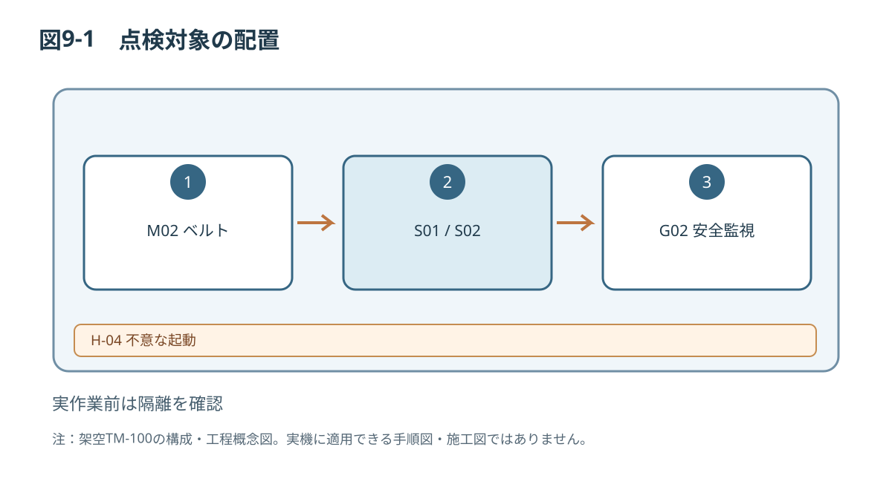

# 第9章 点検・保守

## 9.1 対象者と作業区分
設備管理責任者は計画保全、日常点検、定期点検、交換・修理を区分します。オペレーターが行うのは、ガード外からの目視点検など許可された作業に限ります。ガード内作業や電気作業は保守技術者または資格者が担当します。

## 9.2 保守前の安全確保
> **警告 W-04／H-04：予期しない起動**  
> 停止中でも危険エネルギーが残ることがあります。作業範囲に応じて遮断、再起動防止、残留エネルギーの確認を実施してください。

> **危険 D-01／H-03：電気装置の感電**  
> 制御盤の開放および電気部品の交換は、適切な資格・権限を持つ担当者だけが行ってください。確認済みの無電圧状態を作業開始条件とします。

> **注意 C-02／H-06：鋭利な端部**  
> 部品を交換する際は切創に注意し、作業に適した保護具を使用してください。

## 9.3 点検の分類と周期
| 点検項目 | 日常 | 定期（周期仕様書参照） | 判定の考え方 |
|---|---|---|---|
| ガードG01/G02 | 外観 | 締結・機能 | 損傷・緩み・安全機能異常なし |
| 非常停止装置 | 外観 | 機能 | 承認済み検査で合格 |
| 搬送ベルト | 汚れ・損傷 | 張力・蛇行 | 設計公差内（仕様書参照） |
| S01/S02 | 汚れ・傷 | 検出状態 | 承認基準で合格 |
| A01 | 異物・傷 | 動作状態 | 承認基準で合格 |
| 電気配線・接地 | 外観異常 | 電気的検査 | 資格者が実施 |
| 緊結部 | 脱落 | トルク確認 | 設計指定トルク（仕様書参照） |

保全周期、点検機器、基準値は信頼性評価とリスク評価によって確定する必要があります。指定周期を実運用に転用しないでください。

## 9.4 日常点検の例
1. 運転前点検結果と前シフトの異常履歴を確認する。
2. ガード、配線、表示器に目視できる異常がないことを確認する。
3. ベルトやセンサ周辺の異物を安全な位置から確認する。
4. 不適合を発見した場合は稼働を禁止し、設備管理責任者へ報告する。
5. 点検表に担当者と結果を記入する。

## 9.5 ベルト・センサ保守
機械的な張力調整、蛇行補正、センサ位置調整、プッシャ整備は保守許可作業です。設計図、交換部品番号、締付トルクおよび調整許容差が仕様書に基づいて確認するため、この文書に具体的な分解・調整値は記載しません。

## 9.6 安全装置の定期確認
ガード監視、非常停止、リセット、再起動防止の機能を指定手順で定期検証し、結果と不適合対応を記録します。合格基準、測定方法、点検周期はリスクアセスメント・制御設計と照合して確定します。異常があれば運転を再開しません。

## 9.7 復旧と引渡し
1. 作業終了後、工具・異物・取り外し部品が残っていないことを確認する。
2. ガードと安全機器を指定の状態に戻す。
3. 作業者の退避と周囲の安全を確認する。
4. 権限者が隔離解除および試運転を承認する。
5. 機能確認結果を記録し、問題がなければ運用へ引き渡す。

## 9.8 点検記録
| 日付 | 対象機器 | 点検内容 | 判定 | 是正内容 | 担当・承認 |
|---|---|---|---|---|---|
| （記入欄） | | | | | |

記録様式は付録Bを参照してください。

*図9-1：TM-100の技術文書概念図（寸法・安全性能は未確定）*

