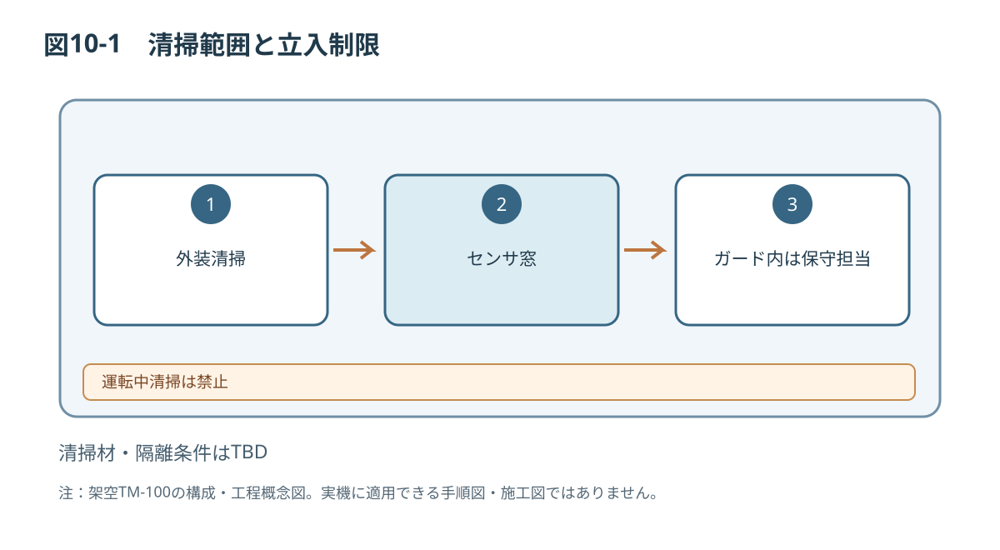

# 第10章 清掃

## 10.1 清掃対象・作業区分
清掃対象は搬送面、外装、センサ窓および排出部です。ガード外から実施可能な日常清掃と、ガード内アクセスを要する保守清掃を明確に区別します。

## 10.2 安全情報
[[safety:W-04]]

[[safety:N-02]]

## 10.3 作業前チェック
清掃範囲、担当者の権限、隔離の必要性、残留ワーク、使用する用具、禁忌材料、清掃後の復旧方法を確認します。推奨清掃液、布材、使用量、乾燥時間は**仕様書参照**とし、安全性評価前に具体的な薬液を指定しません。

[[safety:C-04]]

## 10.4 日常清掃の概念手順
1. 供給停止と装置の停止状態を確認する。
2. 清掃箇所がガード外から安全にアクセス可能であることを確認する。
3. 管理者が承認した清掃用具のみ使用する。
4. 汚れを観察し、指定方法で除去する。危険領域への侵入を伴う場合は中断する。
5. 異物残留やセンサ表示異常がないことを確認する。
6. 実施日、清掃範囲、異常の有無を記録する。

## 10.5 保守清掃
危険領域へのアクセスが必要な場合は、第9章の保守前安全確認、エネルギー隔離、復旧の手順を使用します。取り外し部品の保管、再取付、締付の検証は保守担当者が実施します。

## 10.6 禁止事項・完成判定
運転中の清掃、ガードの無効化、高圧水洗い、承認のない溶剤、センサ窓への硬い工具の使用を禁止する想定です。清掃後は部品と工具の残留がなく、ガードが復旧し、異常表示がないことを確認します。

*図10-1：TM-100の技術文書検証用概念図（寸法・安全性能は未確定）*
