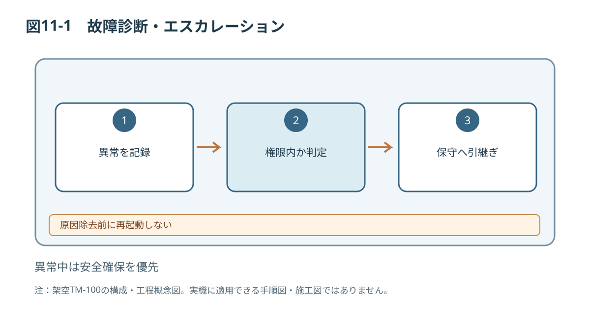

# 第11章 故障診断・修理

## 11.1 異常への対応原則
オペレーターは停止と状況記録、ガード外からの許可された確認までを実施します。危険領域への立入り、配線確認、ガード取外し、部品交換は適切な権限を持つ保守技術者へ引き継ぎます。

[[safety:W-08]]

## 11.2 異常発生時の初動
1. 異常表示、発生時刻、ワーク品種、運転モードを記録する。
2. 必要に応じて停止・非常停止を行う。
3. 人が危険区域にいないことを確認する。
4. オペレーターの作業範囲で原因を特定できない場合は使用を中止する。
5. 保守担当者へエラー履歴と周辺状況を引き継ぐ。

## 11.3 故障コード一覧
| コード | 想定現象 | 想定原因 | オペレーター対応 | 保守対応 |
|---|---|---|---|---|
| E101 | S01ワーク未検出 | ワークなし、検出不良 | 供給・表示を確認、報告 | センサの確認 |
| E102 | S02判定不成立 | 判定信号不正 | 停止・記録 | 検出系の診断 |
| E201 | 搬送異常 | ベルト停滞、詰まり | 停止・報告 | 隔離後に点検 |
| E301 | 排出異常 | A01不動作・詰まり | 停止・報告 | 駆動部と制御確認 |
| E401 | ガード状態異常 | G02開放・故障 | 運転禁止 | 安全機能を検査 |
| E402 | 非常停止入力 | 非常停止操作 | 原因・周囲安全を確認 | 必要に応じ安全確認 |
| E501 | 電源系異常 | 電源不足・配線不良 | 使用停止・報告 | 資格者の電気点検 |

エラーコードと表示内容は、装置の制御仕様書に従って照合してください。

## 11.4 診断フローの考え方
1. 表示コードと異常発生直前の作業を記録する。
2. 人員危険、発煙、露出配線等がある場合は作業を停止し、安全管理者に連絡する。
3. 保守権限の要否を判断し、権限外なら引き継ぐ。
4. ガード外からの外観・記録・表示の確認で原因を絞り込む。
5. 危険領域の点検は保守安全手順に移行する。
6. 是正後は検証、ガード復旧、再起動確認を記録する。

## 11.5 代表的な故障と対処
| 現象 | 確認点 | 対応と停止条件 |
|---|---|---|
| ワークが進まない | エラー、ベルトの外観、供給状態 | 運転停止。詰まりは保守へ |
| 誤排出が多い | 設定レシピ、ワーク仕様 | 試し運転を中止し承認設定と照合 |
| 検出しない | S01/S02の表示、窓汚れ | センサへのアクセス条件を確認 |
| 異音・過熱 | 発生位置、時刻 | ただちに使用中止し点検依頼 |
| ガード異常 | G02の外観 | 安全機能を無効化せず保守へ |

## 11.6 修理と復旧の承認

[[safety:W-03]]

[[safety:W-04]]

修理では交換部品の適合、取り付け条件、配線、保護装置の復旧を検証し、記録します。安全関連部品の交換や制御変更は設計承認と安全機能再検証を必要とします。異常が再発するときは運転を許可しません。

*図11-1：TM-100の技術文書検証用概念図（寸法・安全性能は未確定）*

関連：第2章、第7章、第9章。
