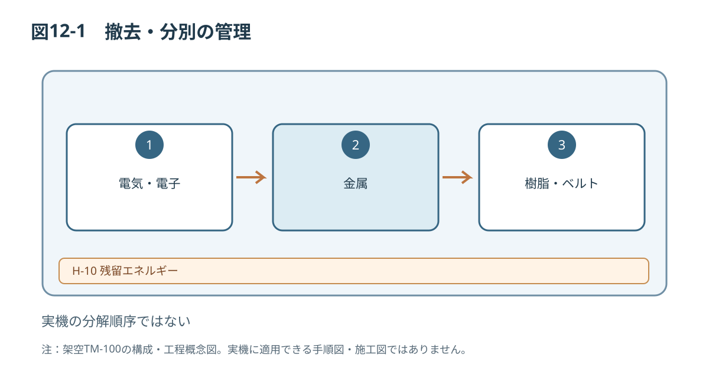

# 第12章 撤去・解体・廃棄

## 12.1 対象作業者
本章は設備管理責任者、撤去事業者、電気担当者および解体担当者を対象とします。撤去前に作業範囲と使用終了状態を記録し、機械の質量、重心、電気回路、保管品、廃棄地域の法令要件を確認します。

## 12.2 主要な危険
[[safety:W-09]]

[[safety:W-06]]

[[safety:C-02]]

[[safety:D-02]]

## 12.3 使用停止の手続き
1. 設備管理責任者が使用終了と作業計画を承認する。
2. 運転履歴、残留ワーク、付属品と異常履歴を記録する。
3. 運転を停止し、設計承認済みの隔離手順を実施する。
4. 資格者が電源・危険エネルギーの除去を確認する。
5. 装置に「使用停止／再使用禁止」の識別表示を行う。
6. 搬出・解体・廃棄の対象物と責任を確認する。

## 12.4 撤去・解体（概念）
機械を支持した状態で、承認済み順序に従って外装、保護装置、搬送部、電気装置、フレームの順に解体することを想定します。ただし、この順序は設計検証済みの具体手順ではありません。固定部品の荷重、配線、取り外しによる転倒などを確認したうえで実機専用手順を確定してください。

## 12.5 分別廃棄
| 分類 | 例 | 記録内容 |
|---|---|---|
| 金属 | フレーム、板金、ねじ | 材質・質量 |
| 電気・電子 | 制御盤、センサ、制御基板 | 回収方法 |
| 樹脂 | ガード、部品 | 材料表示 |
| ゴム・ベルト | 搬送ベルト、支持材 | 分別区分 |
| その他 | 梱包材、配線 | 現地法令に従う |

廃棄方法は法域、材質、有害物質含有、事業者許可条件で異なります。本書の分類表を法的な廃棄指示として使わないでください。

## 12.6 完了記録
撤去日、担当者、隔離検証、搬出、廃棄区分、委託先、残存設備への影響を記録します。再使用する場合は新たな据付・安全確認が必要です。

*図12-1：TM-100の技術文書検証用概念図（寸法・安全性能は未確定）*
